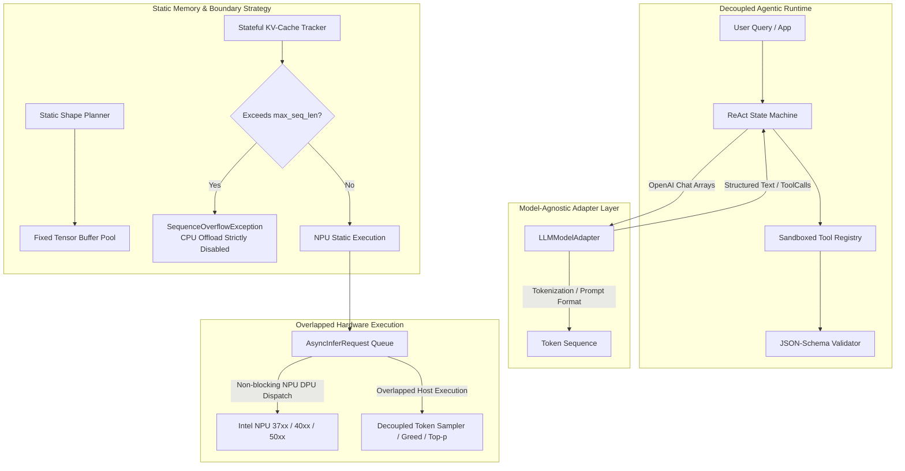

# XpertStream

[](LICENSE)
[](https://en.cppreference.com/w/cpp/20)
[-orange.svg)](https://www.intel.com/)

**XpertStream** is a model-agnostic, agentic inference engine engineered in modern C++ (C++20) for local Intel Neural Processing Units (NPUs), targeting **NPU 37xx** (Meteor Lake / Arrow Lake), **NPU 40xx** (Lunar Lake), and next-generation unreleased architectures (Panther Lake / NPU 50xx).

The engine is architected for maximum hardware throughput and determinism via compile-time static tensor shapes, zero CPU fallback, zero heap allocations on the hot path, stateful OpenVINO KV-cache tracking (`ReadValue`/`Assign`), overlapped asynchronous execution pipelines, and a fully decoupled code-first ReAct agent runtime.

---

## Architecture Overview



---

## Core Architectural Pillars

### 1. Model-Agnostic Adapter Interface
The core engine contains **zero model-specific hardcoding** and **zero direct hardware dependencies**:
- **Interface:** `xpertstream::LLMModelAdapter`
- **Inputs:** Standard OpenAI-style `ChatMessage` sequences (`System`, `User`, `Assistant`, `Tool`).
- **Outputs:** Structured `GenerationOutput` containing decoded text and/or strongly-typed `ToolCall` models.
- **Role:** Handles prompt formatting (e.g. ChatML, Llama-3, Qwen) and token-stream parsing without leaking hardware runtimes into agent logic.

### 2. Static Shape Memory Strategy
Dynamic graph recompilations on Intel NPUs introduce latency spikes, compilation overhead, and unpredictable driver allocations:
- **Batch Size:** Strictly locked to `1` (`StaticTensorShapeConfig::BATCH_SIZE = 1`).
- **Decode Shape:** Locked to static single-token steps `[1, 1]` with position IDs `[1, 1]`.
- **KV-Cache Paradigm:** Stateful graph execution leveraging OpenVINO `ReadValue` and `Assign` operators. Internal attention states reside directly in NPU memory across inference calls, eliminating multi-gigabyte PCIe/SoC transfers per token.
- **Zero-Allocation Hot Path:** `FixedTensorBufferPool` pre-allocates contiguous memory at engine startup.

### 3. Sequence Limit & Hard Exception Boundary
- **Hard Bound:** Statically locked `max_seq_len` determined at graph compilation time.
- **Zero CPU Offload:** Fallback to CPU execution or dynamic graph resizing is strictly rejected to preserve deterministic latency, thermal budgets, and predictable NPU residency.
- **Failure Mode:** If prompt or cumulative autoregressive generation violates `max_seq_len`, the engine immediately throws `xpertstream::SequenceOverflowException` carrying comprehensive diagnostic telemetry:
  - Current sequence tokens count
  - Maximum statically allocated capacity
  - Requested token increment
  - Hardware target architecture
  - Execution phase (`prefill` vs. `decode`)

### 4. Overlapped Asynchronous Execution Pipeline
- **Abstraction:** `xpertstream::AsyncInferencePipeline` wraps OpenVINO non-blocking `AsyncInferRequest` APIs.
- **Decoupled Sampling:** NPU tensor matrix operations are decoupled from host-side token sampling.
- **Double-Buffered Overlap:**
  1. Token pass $N$ is dispatched asynchronously to the NPU queue (`start_async()`).
  2. Host CPU concurrently samples logits of token $N-1$, evaluates repetition penalties, checks stop tokens, and constructs static input buffers for $N+1$.
  3. Host synchronizes on $N$ completion (`wait()`), immediately launches $N+1$, and repeats.

### 5. Decoupled Agent Execution Loop
- **Interface:** `xpertstream::ReActStateMachine`
- **Execution Loop:** Code-first Reasoning $\to$ Action Dispatch $\to$ Observation $\to$ Completion cycle.
- **Isolation:** Operates via an abstract `InferenceInvoker` delegate; completely decoupled from OpenVINO, tensor math, or hardware headers.
- **Tool Sandbox:** `xpertstream::ToolRegistry` and `xpertstream::ISandboxedTool` enforce strict JSON-Schema input validation prior to execution and output schema conformance upon return.

---

## Quick Start: Build & Run

### Prerequisites
- CMake 3.22+
- C++20 compliant compiler (MSVC 2022/2026, Clang 16+, GCC 12+)

### Configure and Build
```powershell
# Generate CMake build directory
cmake -B build -G "Visual Studio 18 2026" -A x64

# Build Release binary
cmake --build build --config Release

# Run the architectural demo
.\build\src\Release\demo_runner.exe
```

---

## Running a Real LLM on Intel NPU

To execute real LLM weights on an Intel NPU (Panther Lake PTL / Lunar Lake / Meteor Lake / Arrow Lake), the model undergoes static-shape compilation and INT4 quantization to match NPU hardware requirements:

### Step 1: Export & Quantize Model for Intel NPU
Use the Windows launcher [ExportNPUModel.cmd](ExportNPUModel.cmd) (modeled with automatic virtual environment creation and dependency bootstrapping, similar to `CheatChess.cmd`):

```bat
:: Recommended Coding Model (Qwen 2.5 Coder 7B - ideal for Panther Lake 18GB / Lunar Lake)
ExportNPUModel.cmd --coder

:: Or using explicit preset:
ExportNPUModel.cmd --preset coder-7b

:: Lightweight coding model (Qwen 2.5 Coder 1.5B - ideal for Meteor Lake NPU 3720)
ExportNPUModel.cmd --preset coder-1.5b

:: One-time login with Hugging Face Token (for gated models like Llama-3.1 / 3.2)
ExportNPUModel.cmd --login
ExportNPUModel.cmd --model-id "meta-llama/Meta-Llama-3.1-8B-Instruct" --output-dir "./models/llama3.1-8b-npu"
```

The launcher:
- Auto-detects Python 3.10+ on the system.
- Creates an isolated `.venv-npu` virtual environment.
- Automatically installs/verifies [requirements-npu.txt](requirements-npu.txt) (`openvino`, `openvino-genai`, `optimum-intel`, `nncf`, `transformers`, `torch`).
- Exports the model with stateful `ReadValue`/`Assign` KV-cache nodes.
- Quantizes weights to INT4 for local NPU bandwidth efficiency (~4.2 GB working set for 7B).
- Generates `npu_static_config.json` locking tensor shapes (`[1, 1]`, `[1, max_seq_len]`).

### Step 2: Interactive Terminal Chat Mode
Launch the multi-turn interactive chat terminal [Chat.cmd](Chat.cmd):

```bat
:: Launch interactive chat session (auto-selects best local accelerator)
Chat.cmd

:: Run the exported Qwen 2.5 Coder 7B specifically on Intel NPU
Chat.cmd --device NPU --coder

:: Or select target silicon explicitly
Chat.cmd --device NPU     :: Intel AI Boost NPU (PTL / Lunar Lake / Meteor Lake)
Chat.cmd --device GPU     :: Intel Arc / Xe Integrated Graphics (fastest response)
Chat.cmd --device CPU     :: Host CPU
```

Features inside the chat session:
- **Streaming Tokens:** Real-time token output with generation throughput (`tokens/sec`).
- **Multi-turn Memory:** Keeps full conversational context across questions.
- **Context Monitoring:** `/tokens` checks used tokens vs. static hardware limit.
- **Context Reset:** `/reset` clears chat history and restarts fresh KV-cache.
- **Custom System Prompt:** `/system <instructions>` updates persona dynamically.

### Step 3: Single-Shot Inference Script
Run one-off prompts with [RunNPU.cmd](RunNPU.cmd):

```bat
RunNPU.cmd "Explain quantum computing in one sentence"
```

### Step 4: C++ Architecture & Engine Interfaces
The concrete C++ hardware backend in [include/xpertstream/runtime/openvino_npu_backend.hpp](include/xpertstream/runtime/openvino_npu_backend.hpp) compiles the model directly to the `"NPU"` execution device with static shape locking (`[1, 1]` decode, `[1, max_seq_len]` attention mask) and zero CPU fallback.

---

## Repository Structure

```
c:\XpertStream\
├── CMakeLists.txt                        # Root CMake configuration (C++20, strict warnings)
├── README.md                             # Architecture blueprint & documentation
├── include/
│   └── xpertstream/
│       ├── common/
│       │   ├── types.hpp                 # ChatMessage, ToolCall, GenerationOutput, TargetNPUArch
│       │   └── exceptions.hpp            # SequenceOverflowException, StaticShapeViolationException
│       ├── adapter/
│       │   ├── model_metadata.hpp        # Vocab, heads, layers, special tokens metadata
│       │   ├── tool_definition.hpp       # JSON-Schema tool parameters definition
│       │   └── llm_model_adapter.hpp     # Abstract LLMModelAdapter base class
│       ├── memory/
│       │   ├── static_tensor_desc.hpp    # Static tensor shape locking configuration
│       │   ├── fixed_tensor_buffer.hpp   # Pre-allocated zero-heap tensor buffers
│       │   └── stateful_kv_cache_tracker.hpp # ReadValue/Assign KV-cache tracker & boundary guard
│       ├── runtime/
│       │   ├── sampler.hpp               # Host-side decoupled token sampler
│       │   ├── npu_backend.hpp           # Hardware abstraction barrier for OpenVINO runtime
│       │   └── async_infer_pipeline.hpp  # Overlapped non-blocking AsyncInferRequest pipeline
│       ├── agent/
│       │   ├── tool_sandbox.hpp          # Sandboxed tool interface & JSON-Schema registry
│       │   └── react_state_machine.hpp   # Code-first ReAct state machine
│       └── engine.hpp                    # Top-level orchestration interface
└── src/
    ├── CMakeLists.txt                    # Interface library & smoke test target
    └── interface_smoke_test.cpp          # C++20 static assertions and signature validation
```
