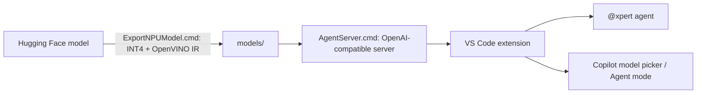

# XpertStream

[](LICENSE)
[](https://www.intel.com/)

**XpertStream** runs local LLMs on Intel hardware (NPU, GPU, CPU) with OpenVINO GenAI and exposes them as a coding agent inside VS Code.



---

## Running a Real LLM on Intel NPU

To execute real LLM weights on an Intel NPU (Panther Lake PTL / Lunar Lake / Meteor Lake / Arrow Lake), the model undergoes static-shape compilation and INT4 quantization to match NPU hardware requirements:

### Step 1: Export & Quantize Model for Intel NPU
Use the Windows launcher [ExportNPUModel.cmd](ExportNPUModel.cmd) (modeled with automatic virtual environment creation and dependency bootstrapping, similar to `CheatChess.cmd`):

```bat
:: Recommended Coding Model (Qwen 2.5 Coder 7B - ideal for Panther Lake 18GB / Lunar Lake)
ExportNPUModel.cmd --coder

:: Or using explicit preset:
ExportNPUModel.cmd --preset coder-7b

:: Lightweight coding model (Qwen 2.5 Coder 1.5B - ideal for Meteor Lake NPU 3720)
ExportNPUModel.cmd --preset coder-1.5b

:: One-time login with Hugging Face Token (for gated models like Llama-3.1 / 3.2)
ExportNPUModel.cmd --login
ExportNPUModel.cmd --model-id "meta-llama/Meta-Llama-3.1-8B-Instruct" --output-dir "./models/llama3.1-8b-npu"
```

The launcher:
- Auto-detects Python 3.10+ on the system.
- Creates an isolated `.venv-npu` virtual environment.
- Automatically installs/verifies [requirements-npu.txt](requirements-npu.txt) (`openvino`, `openvino-genai`, `optimum-intel`, `nncf`, `transformers`, `torch`).
- Exports the model with stateful `ReadValue`/`Assign` KV-cache nodes.
- Quantizes weights to INT4 for local NPU bandwidth efficiency (~4.2 GB working set for 7B).
- Generates `npu_static_config.json` locking tensor shapes (`[1, 1]`, `[1, max_seq_len]`).

### Step 2: Interactive Terminal Chat Mode
Launch the multi-turn interactive chat terminal [Chat.cmd](Chat.cmd):

```bat
:: Launch interactive chat session (auto-selects best local accelerator)
Chat.cmd

:: Run the exported Qwen 2.5 Coder 7B specifically on Intel NPU
Chat.cmd --device NPU --coder

:: Or select target silicon explicitly
Chat.cmd --device NPU     :: Intel AI Boost NPU (PTL / Lunar Lake / Meteor Lake)
Chat.cmd --device GPU     :: Intel Arc / Xe Integrated Graphics (fastest response)
Chat.cmd --device CPU     :: Host CPU
```

Features inside the chat session:
- **Streaming Tokens:** Real-time token output with generation throughput (`tokens/sec`).
- **Multi-turn Memory:** Keeps full conversational context across questions.
- **Context Monitoring:** `/tokens` checks used tokens vs. static hardware limit.
- **Context Reset:** `/reset` clears chat history and restarts fresh KV-cache.
- **Custom System Prompt:** `/system <instructions>` updates persona dynamically.

### Step 3: Single-Shot Inference Script
Run one-off prompts with [RunNPU.cmd](RunNPU.cmd):

```bat
RunNPU.cmd "Explain quantum computing in one sentence"
```

### Step 4: Agent Mode in VS Code Chat (`@xpert`)
The model can act as a coding agent on a workspace through a VS Code chat participant:

- [scripts/agent_server.py](scripts/agent_server.py): local OpenAI-compatible `/v1/chat/completions` server (localhost only) with Qwen `<tool_call>` parsing. The NPU pipeline is compiled with a static prompt budget (`--max-prompt-len`, default 4096) and response budget (`--max-response-len`, default 1024); oversized prompts return `context_length_exceeded`.
- [vscode-xpert/](vscode-xpert/): the `@xpert` chat participant. It runs the agent loop with five tools (`list_files`, `read_file`, `search_text`, `replace_in_file`, `write_file`) confined to the open workspace, and drops old tool output when the NPU context fills up.
- [demo-project/](demo-project/): a 10-file Python to-do app to try the agent on (open it as its own VS Code folder).

```bat
:: 1. Start the server. It also installs/updates the @xpert VS Code extension when needed.
::    (First NPU compile with new budgets takes several minutes; cached afterwards.)
AgentServer.cmd
AgentServer.cmd --device GPU --max-prompt-len 16384

:: 2. Reload VS Code, open any project folder, open Chat, then type e.g.
::    @xpert add a clear-done command that removes completed tasks
::    or pick "XpertStream (local)" in the model picker.
```

---

## Repository Structure

```
c:\XpertStream\
├── ExportNPUModel.cmd            # Download from Hugging Face, INT4-quantize, export to OpenVINO IR
├── Chat.cmd                      # Interactive terminal chat
├── RunNPU.cmd                    # Single-shot prompt
├── AgentServer.cmd               # OpenAI-compatible server for VS Code
├── requirements-npu.txt
├── scripts/
│   ├── export_npu_model.py
│   ├── chat_terminal.py
│   ├── run_npu_genai.py
│   ├── run_npu_inference.py
│   ├── agent_server.py
│   └── install_vscode_extension.py   # Packages and installs vscode-xpert (no Node.js needed)
├── vscode-xpert/                 # VS Code extension: @xpert agent + model-picker provider
├── demo-project/                 # Small Python to-do app for trying the agent
└── models/                       # Exported models (gitignored)
```
